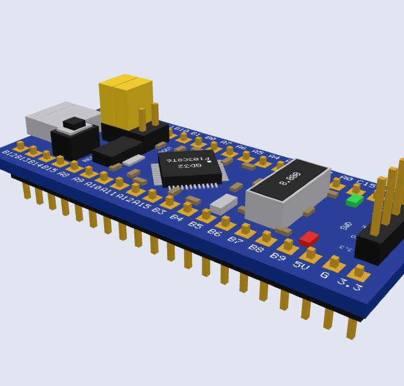
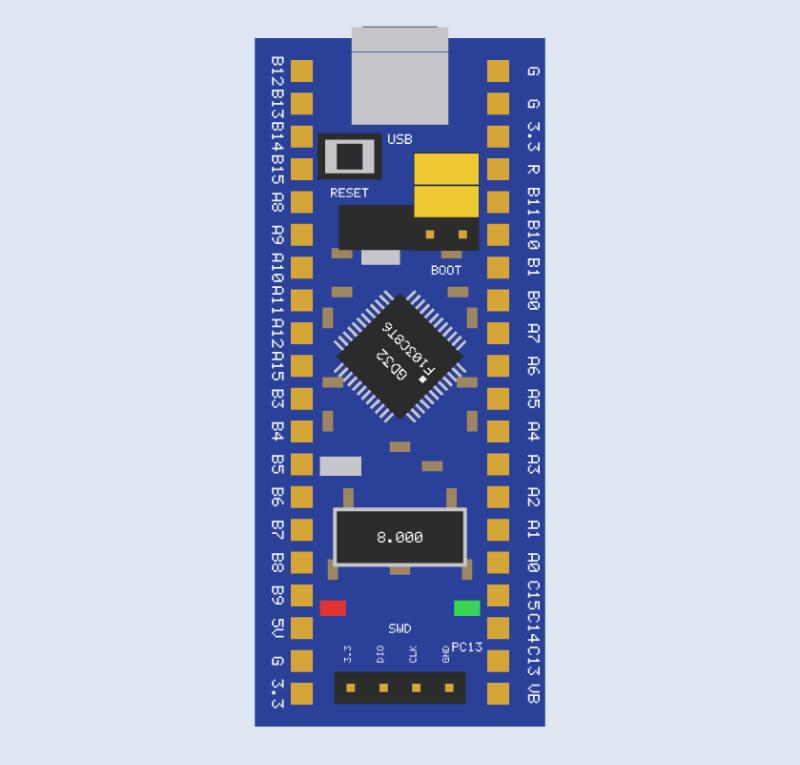
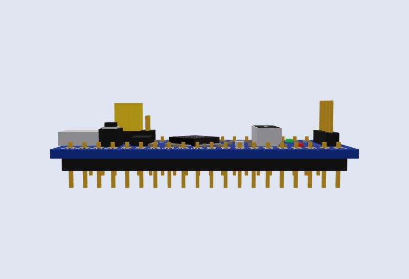

 

**Drop-in 3D models, footprints and symbols for parts the big libraries do not have.**
Pick a part, import it, see it standing on your board in 3D.

   

---

> **About EasyEDA links:** EasyEDA Pro has no public page for a single personal part, so the part is published as an [OSHWLab project](https://oshwlab.com/manoranjan2050/project_txmignpw) (CC BY 4.0, submitted 2026-10-16, listed once EasyEDA finishes its review). The download buttons give the same files straight from this repository. Download the device file, then in EasyEDA Pro use *File, Import, EasyEDA (Professional)*; add the 3D model zip with *New 3D Model*. Step by step in [Quick start](#quick-start-easyeda-pro).

## Why this exists
Arduino Nano and Uno have plenty of models. A Blue Pill style board (STM32F103C8T6 / GD32F103C8T6) had none that worked as a complete, placeable part. So this repo gives you the whole set, not just a picture: **3D model + footprint + symbol**, all with the same pin numbers, ready to use.

## Parts

<table>
<tr>
<td width="46%" align="center"></td>
<td>

### Blue Pill (GD32F103C8T6 / STM32F103C8T6)
Plug-in 2 x 20 module, 53.3 x 22.5 mm.

- 3D model **with** and **without** header pins
- **Solder-in** pins: short tips on top, tails through the PCB
- 40-pad footprint `BLUEPILL_40P`, 40-pin symbol
- EasyEDA Pro device file, KiCad files, VRML and OBJ
- Pin picture with every pin name

[**Open the part**](parts/BluePill-GD32F103C8T6/README.md)

</td>
</tr>
</table>

<table>
<tr>
<td align="center"> Top view with silkscreen</td>
<td align="center"> Side view, pins through the PCB</td>
</tr>
</table>

## Quick start (EasyEDA Pro)
1. **File, Import, EAGLE**, pick `parts/BluePill-GD32F103C8T6/eda/AutoBath_parts_and_BluePill.lbr`, option **Extract Libraries**. The device appears in *Library, Device, Personal* and in the `Shift+F` search.
2. **New 3D Model**, pick the `_obj.zip` from `parts/BluePill-GD32F103C8T6/3d/`, Save.
3. Open footprint `BLUEPILL_40P`, link the 3D model, and set the **3D Z offset to -3.2 mm** so the pin tails show below the board.
4. Place the part in your schematic, update the PCB, and look at the 3D view.

KiCad users: copy the files from [`kicad/`](parts/BluePill-GD32F103C8T6/kicad/) next to the VRML model. Full steps are in the part's README.

## Honest notes
- Measurements come from a photo and community footprints, about plus or minus 0.4 mm. Put calipers on your own board before ordering PCBs. Each part README lists what is **verified** and what is **not**.
- The models are approximate pictures of the module, not maker drawings.

## Rules for every part
- One README per part with *facts and sources* and *still unverified*.
- Footprint, symbol and 3D model share one pin numbering.
- Everything is generated by a script in [`tools/`](tools/), so a corrected measurement is a re-run.
- No logos or website names on the 3D models. Credit goes in the licence.

## Adding a part
1. Create `parts/<Part-Name>/` with `3d`, `easyeda`, `kicad`, `eda` and a README.
2. Add a row to the *Parts* section above.
3. Commit and push.

## Licence
[CC BY 4.0](LICENSE.md): use, change and sell with credit to **ElectroIoT**.

Made by ElectroIoT. Found a wrong dimension? Open an issue with a caliper photo and it will be fixed.

