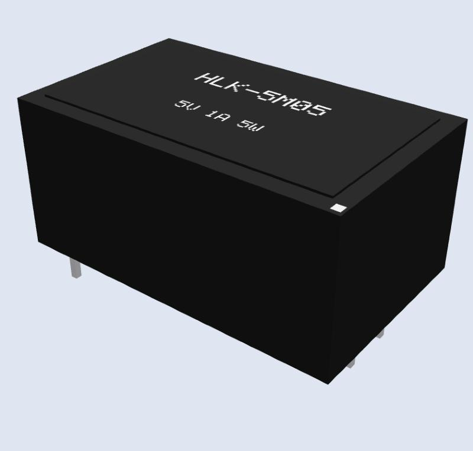

# Hi-Link HLK-5M05 (5 V 1 A, 5 W AC-DC module): 3D model, footprint, symbol

A placeable part for the Hi-Link **HLK-5M05** isolated AC-DC converter (85-264 VAC in, 5 V out, 4 through-hole pins): 3D model + 4-pad footprint + 4-pin symbol, with the same pin numbers. EasyEDA's own library lists this part but only with a plain black box; this one is drawn with the real pin positions and height so a carrier board can be checked in 3D.

| What | File |
|---|---|
| 3D model, EasyEDA Pro | `3d/HLK-5M05_obj.zip` (OBJ + MTL, title `hlk-5m05_rev1`) |
| 3D model, VRML | `3d/HLK-5M05_mm.wrl` (mm), `3d/HLK-5M05_kicad_scale.wrl` (KiCad scale) |
| EasyEDA / EAGLE library | `eda/HLK-5M05.lbr` (device `HLK-5M05_3D`, footprint `HLK-5M05_TH`) |
| KiCad | `kicad/HLK-5M05.kicad_mod`, `kicad/HLK-5M05.kicad_sym` |

## Pins
| Pin | Name | Position (mm, pin 1 = upper left, y up, centre of body = 0/0) |
|---|---|---|
| 1 | AC (L or N) | -16.8 / +3 |
| 2 | AC (N or L) | -16.8 / -3 |
| 3 | -Vo | +16.8 / +9 |
| 4 | +Vo | +16.8 / -9 |

Pad: drill 1.0 mm, 1.7 x 2.0 mm oval (EasyEDA library version uses 2.0 mm round).

## Facts used and where they come from
Taken from the KiCad library footprint `Converter_ACDC_Hi-Link_HLK-5Mxx`, which cites the Hi-Link 5 W series datasheet V2.8: pins 6 mm apart on the AC side and 18 mm apart on the DC side, 33.6 mm between the two pin rows, body about 39.0 x 23.5 mm, height about 18.1 mm, pins about 4.9 mm below the PCB surface. Only these numbers were used; the mesh and footprint here are drawn from scratch (the KiCad STEP model is CC BY-SA and is not copied). The EasyEDA library lists several 5M05 variants with different footprints (for example 38 x 23 mm clones and a 39 x 23.5 mm "B" type): **this part is the original 5M05 pin layout, check that it matches the module you buy.**

## Still unverified
- The datasheet PDF could not be opened here; the numbers come through the KiCad footprint. Check with calipers on your module.
- The outline and height are approximate and the model has no screw holes, labels or markings of the real case beyond the product name and rating text.
- **Mains part.** Keep the AC side and the DC side apart on your PCB and follow your local rules; this repository gives dimensions, not a safety review.

## Use it in EasyEDA Pro
1. File, Import, EAGLE, pick `eda/HLK-5M05.lbr`, option Extract Libraries.
2. New 3D Model, pick `3d/HLK-5M05_obj.zip`, Save.
3. Open footprint `HLK-5M05_TH`, link the 3D model, and set the 3D **Z offset to -4.9 mm** so the pin tails show below the board.

## Regenerate
`python tools/gen_hlk5m05.py`

Licence: CC BY 4.0, see [`../../LICENSE.md`](../../LICENSE.md).
